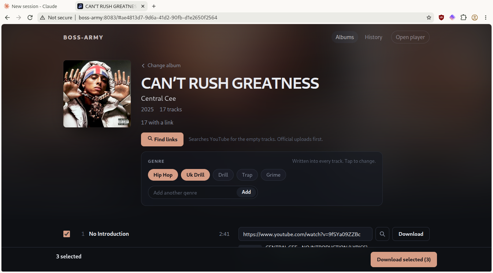
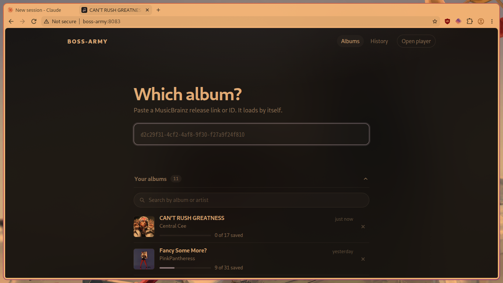

# music-downloader

A self-hosted web app that builds a properly tagged music library from YouTube, the way Lidarr organises one.
You give it a MusicBrainz album, it finds the right video for every track, downloads the audio as MP3, and
saves it in `Artist/Album/` with correct tags and cover art.

Made for a home server: it runs as one small Flask service and works fine from a phone over Tailscale.





## What it does

- **Start from MusicBrainz.** Paste a release link or ID. The album loads by itself, with its track list,
  lengths and cover.
- **Find links automatically.** One button searches YouTube for every empty track. It keeps only videos
  whose length matches the album (within about 5 seconds), skips live and remix versions, prefers the
  artist's own channel (or their "Topic" channel), then higher audio bitrate, then views. You can swap any
  pick for another result in one click, or paste your own link.
- **Checks every link.** Each row shows a thumbnail, the video title, its length and a verdict:
  "Length matches", or "Video is 3:40, album says 3:20".
- **Tags properly.** Title, artist, album artist, album, year, track and disc numbers, genre and embedded
  cover (only from the Cover Art Archive, never a video thumbnail).
- **Genre box.** Genres come pre-filled from MusicBrainz. You choose, and they are written into every track.
- **Background queue.** Downloads keep running if you close the tab. Progress, cancel and retry all work.
- **History and albums.** Every finished download is listed by day, and failed ones reopen with their link
  filled in. The albums you have opened are kept for later, with a search box.
- **Small database.** One SQLite file remembers your links, queue, history and genres.

## Requirements

- Python 3.10 or newer
- [yt-dlp](https://github.com/yt-dlp/yt-dlp) and [ffmpeg](https://ffmpeg.org/) on your `PATH`
- Optional: `mpc`, if you use MPD. The app runs `mpc update` after a batch so new music shows up.

On Arch Linux:

```
sudo pacman -S yt-dlp ffmpeg python-flask python-mutagen
```

On other systems:

```
pip install -r requirements.txt
```

## Run it

```
git clone https://github.com/staystillplease7-png/music-downloader.git
cd music-downloader
MUSIC_DIR=~/Music python3 app.py
```

Then open `http://localhost:8083`.

## Settings

Everything is set with environment variables, so you never have to edit the code.

| Variable | What it does | Default |
| --- | --- | --- |
| `MUSIC_DIR` | Where finished albums are saved | `/srv/media/music` |
| `PLAYER_URL` | Address for the "Open player" button. Leave empty to hide it | none |
| `DB_PATH` | The SQLite file | `boss-army.db` next to `app.py` |
| `MB_CONTACT` | Contact MusicBrainz can reach you on. Set your own email or site | this repository's URL |
| `HOST` | Address to listen on | `0.0.0.0` |
| `PORT` | Port to listen on | `8083` |

MusicBrainz asks every app to identify itself with a contact in its requests, so please set `MB_CONTACT`
if you run this a lot.

## Run it as a service (systemd)

Save as `/etc/systemd/system/music-downloader.service`, fixing the user and paths:

```
[Unit]
Description=music-downloader
After=network.target

[Service]
User=youruser
WorkingDirectory=/home/youruser/music-downloader
Environment=MUSIC_DIR=/srv/media/music
Environment=PLAYER_URL=http://your-server:8082/
Environment=MB_CONTACT=you@example.com
ExecStart=/usr/bin/python3 app.py
Restart=on-failure

[Install]
WantedBy=multi-user.target
```

```
sudo systemctl daemon-reload
sudo systemctl enable --now music-downloader
```

## How it works

- `app.py` is the whole backend: Flask routes, the MusicBrainz and Cover Art Archive lookups,
  `yt-dlp` driven through `subprocess`, ID3 tagging with `mutagen`, a two-worker download queue and the
  SQLite storage.
- `templates/index.html`, `static/app.js` and `static/style.css` are a single-page interface with no
  framework or build step.
- MusicBrainz is limited to one request per second, as its rules ask.

## Security note

There is no login. Run it on a trusted network, such as your home LAN or a Tailscale network, and do not
expose it to the internet.

## Use it responsibly

Download only music you have the right to download, and follow the terms of the services you use.
This project is a personal tool and is not affiliated with YouTube or MusicBrainz.

## License

MIT, see [LICENSE](LICENSE).
